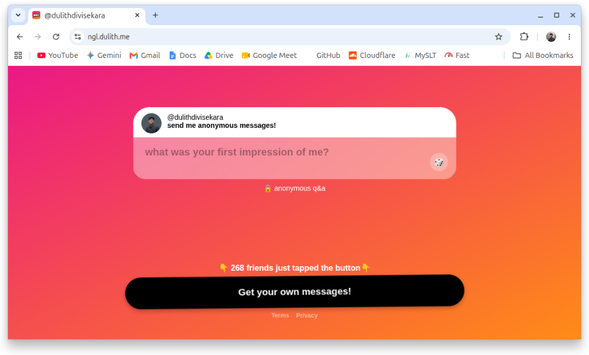
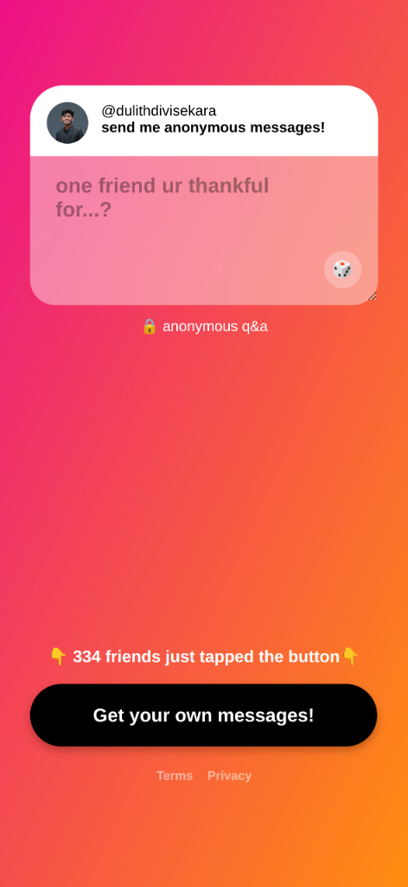
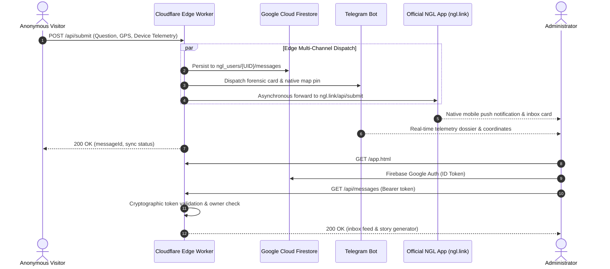
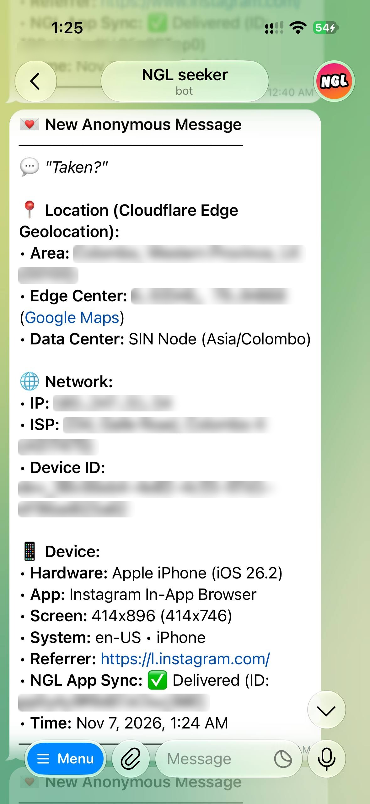
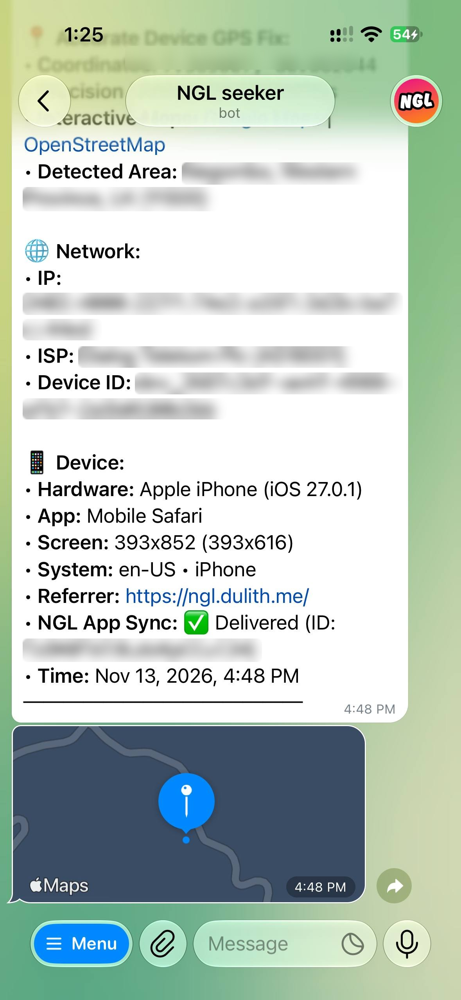

<p align="center">
  <a href="https://ngl.dulith.me" target="_blank" rel="noopener noreferrer">
    
  </a>
</p>

<h1 align="center">ngl-pro</h1>

<p align="center">
  High-performance anonymous Q&amp;A platform featuring 1:1 NGL parity, multi-channel dual-dispatch, real-time Telegram forensics, and a serverless edge architecture.
</p>

<p align="center">
  <a href="#"></a>
  <a href="#"></a>
  <a href="#"></a>
  <a href="#"></a>
  <a href="LICENSE"></a>
</p>

<p align="center">
  <a href="#overview">Overview</a> &bull;
  <a href="#visual-previews">Previews</a> &bull;
  <a href="#architecture">Architecture</a> &bull;
  <a href="#operational-matrix">Matrix</a> &bull;
  <a href="#project-structure">Structure</a> &bull;
  <a href="#forensics--telemetry">Forensics</a> &bull;
  <a href="#security-model--hardening">Security</a> &bull;
  <a href="#deployment">Deployment</a> &bull;
  <a href="#credits">Credits</a> &bull;
  <a href="#license">License</a>
</p>

---

## Overview

**ngl-pro** is an enterprise-grade, serverless anonymous messaging engine. Designed with strict 1:1 behavioral and visual fidelity to the original NGL client, it incorporates multi-channel upstream dispatch, detailed device forensics, first-party edge authentication proxying, and cryptographic identity verification.

The platform executes globally on Cloudflare Pages Advanced Mode (`_worker.js`), requiring zero persistent origin servers. Every anonymous submission is processed at the edge, logged into Google Cloud Firestore, dispatched via Telegram Bot with live geographic data, and mirrored to the recipient's official NGL mobile app inbox simultaneously. Furthermore, Firebase Authentication is proxied directly through the primary apex/subdomain (`ngl.dulith.me/__/auth/*`), eliminating third-party cookie restrictions and cross-domain tracking warnings.

---

## Visual Previews

<div align="center">
  <table border="0">
    <tr>
      <td width="65%" align="center" valign="top">
        <p><strong>Desktop Ingress &amp; Interaction View</strong></p>
        
      </td>
      <td width="35%" align="center" valign="top">
        <p><strong>Mobile Edge View</strong></p>
        
      </td>
    </tr>
  </table>
</div>

---

## Architecture

The system coordinates anonymous ingress with an administrative portal through asynchronous edge compute and multi-channel synchronization:



---

## Operational Matrix

| Dimension | Public Ingress Surface | Administrative Inbox Portal |
| :--- | :--- | :--- |
| **Route Path** | `/` (`index.html`), `/p/sent.html` | `/app.html` |
| **Authentication** | Anonymous (Unauthenticated edge ingress) | Firebase Auth (`Bearer <Google ID Token>`) |
| **Edge Handlers** | `POST /api/submit` | `GET /api/messages`, `POST /api/messages` |
| **Downstream Sync** | Firestore, Telegram Bot, Official NGL API | Firestore Document Patch & Reply Generator |
| **Rate Limiting** | Edge Client Telemetry, IP & Device Hash | Cryptographic Session Verification |
| **Display Modes** | Compact Summary Card & Wide Landscape Banner | Authenticated Web Dashboard & Story Exporter |

---

## Project Structure

```
.
├── .github/                   # Community health, security policy & contributor guidelines
│   ├── CODE_OF_CONDUCT.md     # Contributor Covenant v2.1 community guidelines
│   ├── CONTRIBUTING.md        # Collaboration, branching, and pull request standards
│   ├── SECURITY.md            # Security policy, threat model, and vulnerability reporting
│   └── SUPPORT.md             # Support channels, FAQs, and incident escalation
├── assets/                    # Repository documentation assets and previews
│   ├── logo.png               # Official high-resolution NGL squircle mark
│   ├── desktop_preview.png    # Live desktop interface render
│   ├── mobile_preview.png     # Live mobile viewport render
│   ├── telegram_preview_1.jpg # Redacted Telegram notification (Edge Geo card)
│   └── telegram_preview_2.jpg # Redacted Telegram notification (GPS fix & map pin)
├── firebase.json              # Firebase project services, hosting & auth configuration
├── firestore.rules            # Strict collection-level security rules for ngl_users
├── package.json               # Project manifest, dependencies, and build scripts
├── wrangler.toml              # Cloudflare Pages edge runtime definition
├── .dev.vars.example          # Template for local environment secrets
└── public/                    # Production static build & edge worker
    ├── _worker.js             # Cloudflare Pages Advanced Mode edge handler & REST API
    ├── index.html             # 1:1 anonymous question submission interface
    ├── app.html               # Authenticated administrative portal & story generator
    ├── p/
    │   └── sent.html          # 1:1 submission confirmation interface
    ├── images/
    │   ├── ngl.png            # Solid RGB square Open Graph card (512x512)
    │   ├── ngl_banner.png     # 1200x630 landscape Open Graph banner
    │   └── avatar.webp        # Compressed transparent profile avatar
    └── scripts/
        ├── main.js            # Submit button lifecycle, viewport listeners & dice randomizer
        ├── app.js             # Administrative inbox manager, auth gate & story canvas
        └── telemetry.js       # Client-side hardware, network & GPS geolocation sampler
```

---

## Forensics & Telemetry

When an anonymous message is submitted, the Cloudflare Edge Worker captures non-identifying technical forensics and dispatches an actionable security card to the owner's Telegram bot:

* **Geographic Resolution**: Latitude and longitude (with native Telegram interactive map pin when GPS is granted), reverse-geocoded city, region, postal code, and country.
* **Network Context**: Client IP address, Internet Service Provider (ISP), Autonomous System Number (ASN), and Cloudflare Data Center node (`colo`).
* **Device Identification**: Operating system, hardware family, screen resolution, viewport dimensions, system language, and browser application context (e.g., Safari, Chrome, Instagram In-App, Snapchat WebView).
* **Upstream Sync Reference**: Tracking ID returned by the official NGL backend confirming delivery to the mobile app inbox.

<div align="center">
  <table border="0">
    <tr>
      <td width="50%" align="center" valign="top">
        <p><strong>Cloudflare Edge Geolocation Dispatch</strong></p>
        
      </td>
      <td width="50%" align="center" valign="top">
        <p><strong>GPS Telemetry &amp; Native Map Pin</strong></p>
        
      </td>
    </tr>
  </table>
</div>

---

## Security Model & Hardening

The repository enforces a zero-trust architecture across all operational endpoints with defense-in-depth mitigations:

### 1. Edge-Level Credential Isolation
* **Zero Source Secrets**: No API keys, bot tokens, personal emails, upstream NGL usernames, or owner UIDs exist in the source code or commit history. Local development uses `.dev.vars` (enforced by `.gitignore`).
* **Encrypted Secrets**: Production runtime credentials (`FIREBASE_API_KEY`, `OWNER_EMAIL`, `OWNER_UID`, `NGL_UPSTREAM_USERNAME`, `TELEGRAM_BOT_TOKEN`, `TELEGRAM_CHAT_ID`) reside exclusively within Cloudflare Pages encrypted environment variables and are never leaked by unauthenticated API routes (`/api/config`).
* **Webhook Authorization**: `/api/telegram-webhook` validates incoming chat IDs against `TELEGRAM_CHAT_ID` (and optional `TELEGRAM_WEBHOOK_SECRET`), preventing unauthorized probing of bot commands.

### 2. First-Party Custom Auth Domain Proxy
* **Edge Proxy Handler**: Requests targeting `/__/auth/*` are intercepted by `_worker.js` at the Cloudflare Edge and reverse-proxied with rewritten `X-Forwarded-Host: ngl.dulith.me` headers to Google Identity Toolkit (`ngl-dulith.firebaseapp.com`).
* **Privacy & Cookie Resiliency**: Google sign-in workflows run in a 100% first-party context, preventing Safari ITP and Chrome third-party cookie phase-out disruptions.
* **Authorized Redirect Safeguards**: Authorized redirect URIs in `firebase.json` explicitly whitelist only `https://ngl.dulith.me/__/auth/handler` and `http://localhost:8788/__/auth/handler`.

### 3. Google Cloud API Key Restrictions (Production Checklist)
To prevent unauthorized consumption of client-facing Google Cloud identifiers:
* **Application Restrictions**: Set to **Websites (HTTP referrers)** restricted to:
  * `https://ngl.dulith.me/*`
  * `https://ngl-dulith.pages.dev/*`
  * `https://ngl-dulith.firebaseapp.com/*`
* **API Restrictions**: Restrict the key to only:
  * `Identity Toolkit API`
  * `Cloud Firestore API`
  * `Secure Token Service API`
* **Firestore Security Rules**: Database rules enforce that non-authenticated clients have zero read or list access to `ngl_users`, while authenticated queries strictly require `request.auth.uid == userId`.

---

## Deployment

### Prerequisites

* [Node.js](https://nodejs.org/) (v18+)
* [Wrangler CLI](https://developers.cloudflare.com/workers/wrangler/)
* [Firebase CLI](https://firebase.google.com/docs/cli)

### Environment Configuration

Create `.dev.vars` for local development:

```bash
cp .dev.vars.example .dev.vars
```

Populate the required secrets:

```ini
FIREBASE_API_KEY=your_firebase_api_key
OWNER_EMAIL=owner@example.com
OWNER_UID=your_firebase_owner_uid
NGL_UPSTREAM_USERNAME=
TELEGRAM_BOT_TOKEN=your_telegram_bot_token
TELEGRAM_CHAT_ID=your_telegram_chat_id
```

### Build & Deploy

Deploy static assets and Edge Worker to Cloudflare Pages:

```bash
npx wrangler pages deploy public --project-name ngl-dulith --branch main
```

Deploy Firebase Auth configuration (authorized domains and redirect URIs):

```bash
npx firebase deploy --only auth
```

Deploy Firestore security rules:

```bash
npx firebase deploy --only firestore:rules
```

---

## Credits

Special thanks to **[Kesaru Hasun](https://github.com/kesaruhasun)** for the initial project concept and early codebase foundation.

---

## License

This project is licensed under the MIT License - see the [LICENSE](LICENSE) file for details.
